# LUXWATCH: the marketplace

[](https://github.com/Hikki-dev/Laravel-Watch/actions/workflows/checks.yml)
[](https://luxwatch-livid.vercel.app)
[](LICENSE)


A luxury watch marketplace you can try in your browser. Buyers find a watch and turn it in their hands, sellers list their own, and an admin approves everything before it goes live.

<p align="center"><a href="https://luxwatch-livid.vercel.app">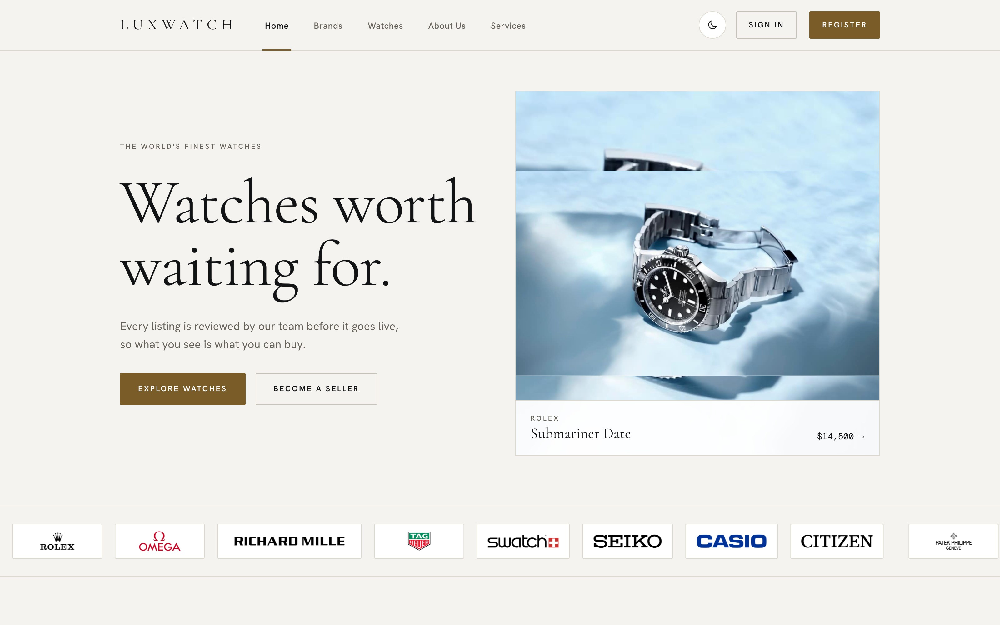</a></p>

<p align="center"><sub>The live home page. <b><a href="https://luxwatch-livid.vercel.app">Open the live demo</a></b>, or scroll down for a walkthrough of every screen.</sub></p>

It is a portfolio project, built to show how a careful, well designed store is put together from the first page to the payout.

**This is one half of a pair.** Laravel-Watch is the **marketplace**: the website, the database and the REST API. [Watch-final](https://github.com/Hikki-dev/Watch-final) is the **shopper app**: a Flutter app that signs people in with Firebase and then talks to this store's API. Read [The phone app](docs/The%20phone%20app.md) to see how the two meet.

You do not need to know Laravel to follow this page. Everything is explained in plain words, one step at a time.

## On this page

* [What you get](#what-you-get): the parts of the store
* [How everything fits together](#how-everything-fits-together): from a click to the database
* [Two repos, one store](#two-repos-one-store): the marketplace and the shopper app
* [Try it first](#try-it-first): the live demo
* [Before you start](#before-you-start): what your computer needs
* [Run it yourself](#run-it-yourself): ten minutes to a working store
* [The store, step by step](#the-store-step-by-step)
  * [1. The home page](#1-the-home-page)
  * [2. The collection](#2-the-collection)
  * [3. Filter by brand](#3-filter-by-brand)
  * [4. A watch up close](#4-a-watch-up-close)
  * [5. The 360° view](#5-the-360-view)
  * [6. Brands](#6-brands)
  * [7. Signing in](#7-signing-in)
  * [8. Creating an account](#8-creating-an-account)
  * [9. Light and dark](#9-light-and-dark)
  * [10. About and services](#10-about-and-services)
  * [11. The customer area](#11-the-customer-area)
  * [12. The seller area](#12-the-seller-area)
  * [13. The admin area and approvals](#13-the-admin-area-and-approvals)
  * [14. On a phone](#14-on-a-phone)
* [Under the hood](#under-the-hood)
* [Put it online](#put-it-online)
* [Your privacy and safety](#your-privacy-and-safety)
* [Help and more reading](#help-and-more-reading)
* [Legal and the pictures](#legal-and-the-pictures)

## What you get

Each part does one small job. Together they make a store that feels like the real ones.

| | What | What it does |
|---|---|---|
| 🛍️ | **Storefront** | A light and dark theme, brand logos, search, filters and photos that always fit |
| 🔄 | **360° views** | Drag a watch round with your finger, the way the big brand sites do |
| 👤 | **Three roles** | Customers buy, sellers list, admins approve |
| ✅ | **Approvals** | New watches and brands stay hidden until an admin says yes |
| 🛒 | **Cart and checkout** | Stripe Checkout, tax added, order history |
| 💸 | **Seller payouts** | Stripe Connect pays sellers when they sell |
| 🔐 | **Sign in** | Email and password, Google, two factor, API tokens (Jetstream) |
| 📱 | **REST API** | Token based, used by the Flutter app. See the [API reference](docs/API.md) |
| ☁️ | **Serverless ready** | Runs on Vercel with a Neon Postgres database, or on a normal server with MySQL |

## How everything fits together

A visitor opens a page. Vercel serves the photos and scripts straight away, and asks Laravel for the page itself. Laravel reads the watches from the database, builds the page and sends it back. The phone app asks the same Laravel for JSON instead. Payments go to Stripe.

<p align="center"><a href="docs/images/how-it-fits.svg">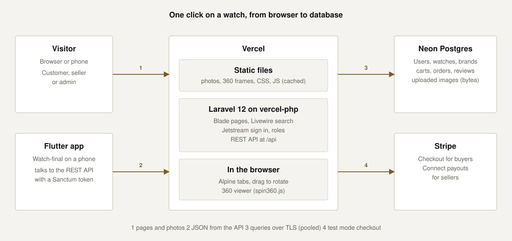</a></p>

The full story of one watch, from a seller listing it to a customer receiving it, is in [How everything fits](docs/How%20everything%20fits.md).

## Two repos, one store

| | Laravel-Watch (this repo) | [Watch-final](https://github.com/Hikki-dev/Watch-final) |
|---|---|---|
| **Role** | The marketplace: website, database, API | The shopper app on phones, tablets and the web |
| **Built with** | Laravel 12, Livewire, Postgres or MySQL | Flutter, Firebase sign in, Hive cache |
| **Who uses it** | Customers, sellers and admins, in a browser | Customers, sellers and admins, in the app |
| **Holds the data?** | Yes. Watches, orders and accounts live here | No. It asks this API for everything and keeps a local copy to start fast |

The app signs a person in with Firebase, then trades that sign in for an API token at `POST /api/auth/google`. From then on every request carries the token, and the roles checked on the website are checked on the API too. The routes the app uses are listed in the [API reference](docs/API.md).

## Try it first

**[Open the live demo](https://luxwatch-livid.vercel.app).** Browse the collection, search, filter by brand, open a watch and register as a customer. Nothing is sold, and no real money moves.

The seller and admin accounts are private, but the [walkthrough below](#the-store-step-by-step) shows every screen of them.

## Before you start

You need three things:

1. PHP 8.2 or newer and Composer.
2. Node 20 or newer.
3. Nothing else. The first run uses a SQLite file, so there is no database to install.

## Run it yourself

```bash
git clone https://github.com/Hikki-dev/Laravel-Watch.git
cd Laravel-Watch
composer install
npm install
cp .env.example .env
php artisan key:generate
touch database/database.sqlite
php artisan migrate --seed
npm run build
php artisan serve
```

Open <http://localhost:8000>. The seeder makes 17 watches and three accounts (`customer@`, `seller@` and `admin@example.com`, password `password`). Check everything with `php artisan test`.

More detail, and what to do if something does not work, is in [Getting started](docs/Getting%20started.md) and [Fixing problems](docs/Fixing%20problems.md).

## The store, step by step

This walkthrough follows a visitor from the first page to the admin tools. Pictures 1 to 10 and 14 (the public pages and the phone) were taken from the live demo at twice the usual sharpness. The signed in screens in steps 11 to 13 were taken from a copy of the store running on `localhost` with the sample data and the sample accounts, because the live demo keeps its accounts private. Click a picture to see it full size.

### 1. The home page

<a href="docs/images/01-home.jpg"></a>

**What you see.** A big headline, "Watches worth waiting for.", and one featured watch. Two buttons sit under it: **Explore watches** and **Become a seller**. A row of real brand logos scrolls by under the hero.

**What comes next.** Scroll down for the newest arrivals ("Just listed"), a shortcut to each brand ("Shop by brand"), and a short pitch for sellers in three steps: list, review, get paid. The page ends with a footer and an email box to join the mailing list.

**Good to know.** The line under the headline says the whole idea in one sentence: every listing is reviewed before it goes live, so what you see is what you can buy.

### 2. The collection

<a href="docs/images/02-collection.jpg">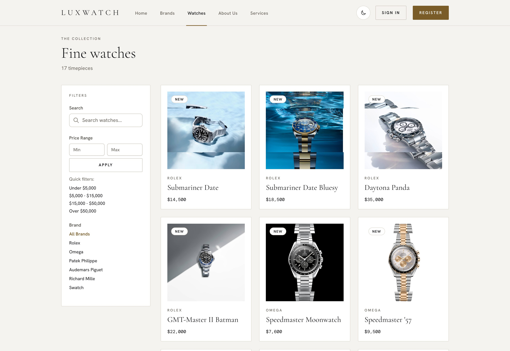</a>

**What you see.** "Fine watches" and a count ("17 timepieces" on the demo). The filters are on the left and the watches on the right, three to a row.

**What to do.** Type in the search box, set a price range and press **Apply**, or use a quick filter: under $5,000, $5,000 to $15,000, $15,000 to $50,000 or over $50,000. Each card shows the brand, the model and the price. Open one by clicking it.

**Good to know.** Search ignores capital letters and only lists watches that are switched on.

### 3. Filter by brand

<a href="docs/images/13-brand-filter.jpg">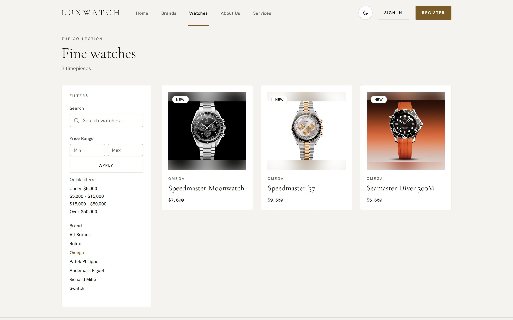</a>

**What you see.** The same page, narrowed to one maker. Here the brand list on the left has **Omega** picked, and the count drops to three watches.

**What to do.** Click a brand name in the filter list, or a brand card on the home page, to jump straight to its watches. **All Brands** takes you back.

### 4. A watch up close

<a href="docs/images/03-watch.jpg">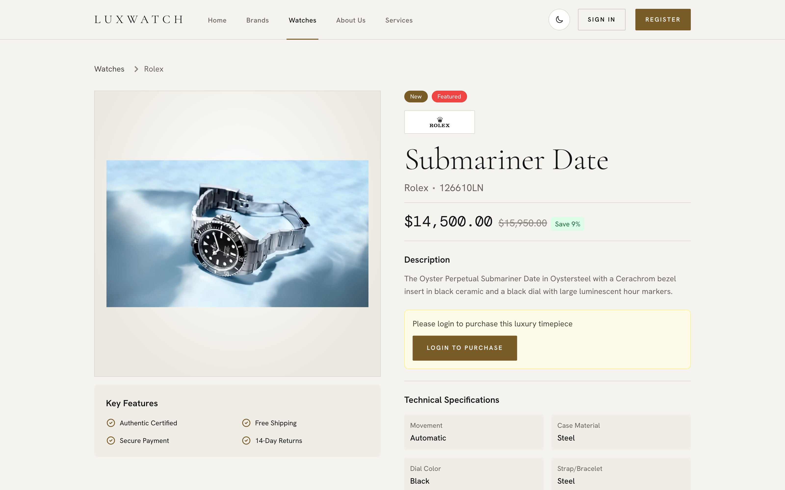</a>

**What you see.** The photo on the left, sitting on a soft backdrop so any photo fits. On the right: the badges (**New**, **Featured**), the brand logo, the model name, the brand and reference number, and the price. When there is an older price, it is shown struck through with the saving.

**What to do.** Read the description. If you are signed in as a customer you can add the watch to your cart. If you are not, the page says "Please login to purchase this luxury timepiece" and offers a button.

Scroll on for the details:

<a href="docs/images/17-watch-details.jpg">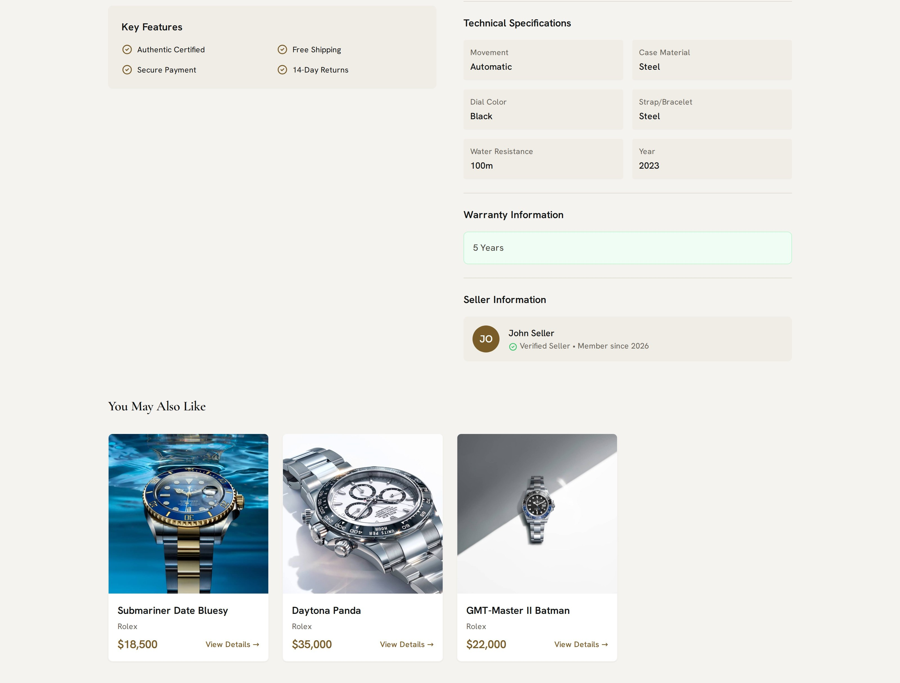</a>

**What comes next.** Technical specifications (movement, case material, dial colour, strap or bracelet, water resistance and year), the warranty, who the seller is, and a row of related watches under **You may also like**.

### 5. The 360° view

When a watch has a 360° set, a **360°** tab appears next to the photos. You drag the watch round, and buttons jump to the front, the angle, the side or the case back. It is a row of photos, not a 3D model, so it is smooth even on a phone. The full story is in [The 360 viewer](docs/The%20360%20viewer.md).

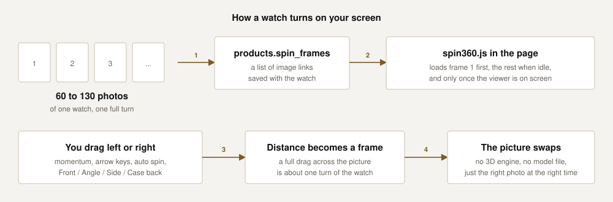

### 6. Brands

<a href="docs/images/04-brands.jpg">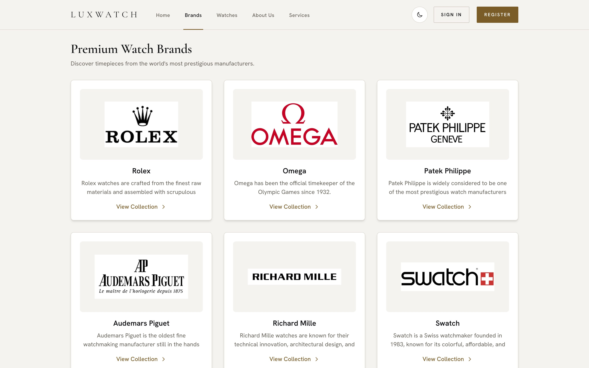</a>

**What you see.** One card for each maker, with its logo and a short description.

**Good to know.** Admins approve new brands before they appear. Every logo comes from one shared component, so it looks the same on every page.

### 7. Signing in

<a href="docs/images/05-sign-in.jpg">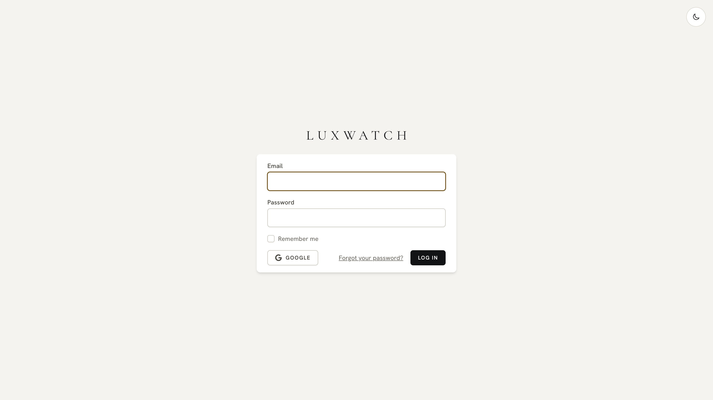</a>

**What to do.** Email and password, or Google. Two factor sign in and personal API tokens are in the profile.

**Good to know.** An account can be switched off by an admin, and it is signed out on its next click.

### 8. Creating an account

<a href="docs/images/14-register.jpg">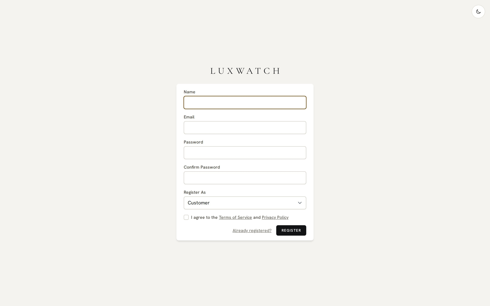</a>

**What to do.** Fill in your name, email, a password and the password again, tick the box for the terms of service and the privacy policy, then press **Register**. The **Register as** box starts on **Customer**. Already have an account? **Already registered?** takes you to sign in.

**Good to know.** Passwords are hashed. A new account starts with the least it can do. A seller's watches and brands wait for an admin before anyone can see them.

### 9. Light and dark

<a href="docs/images/11-dark-home.jpg">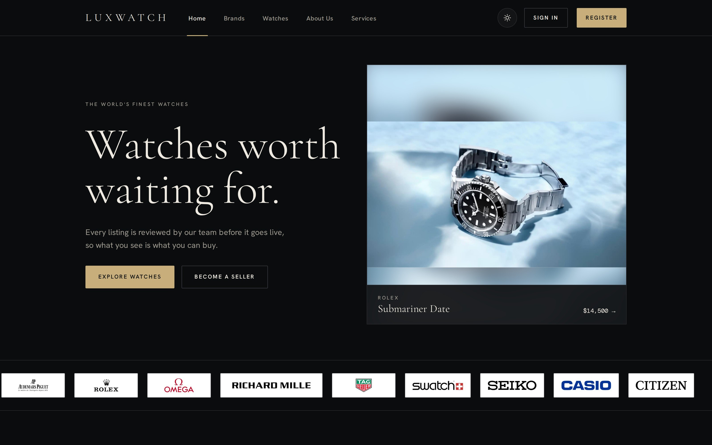</a>

**What to do.** The round button at the top of every page, next to **Sign in**, switches between light and dark. Your choice is remembered in your browser.

<a href="docs/images/12-dark-watch.jpg">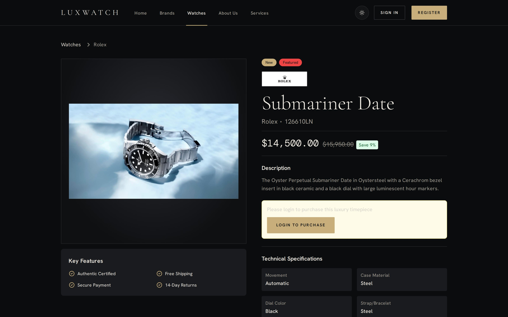</a>

**Good to know.** Both themes use one set of colour names, so every page follows them. One part of the watch page, the "please log in" box, keeps its light colours in the dark theme.

### 10. About and services

<a href="docs/images/15-about.jpg">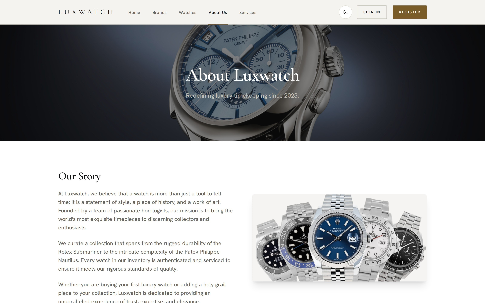</a>

**What you see.** The **About us** page tells the story of the store and shows a photo of several watches.

<a href="docs/images/16-services.jpg">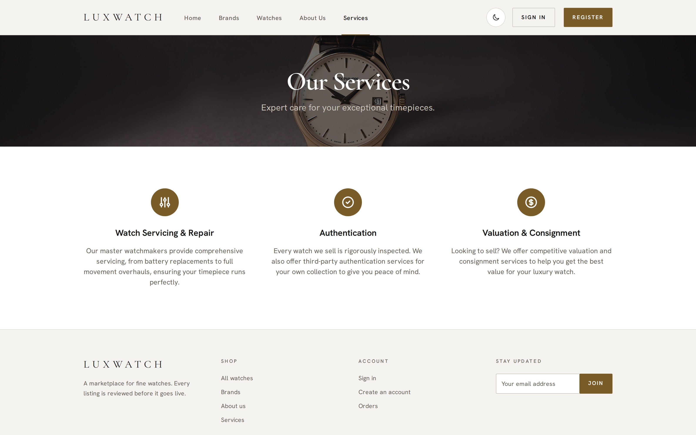</a>

**Services** lists three things the store says it offers: watch servicing and repair, authentication, and valuation and consignment. These pages are plain text for the demo. Nothing on them is a booking system.

### 11. The customer area

<a href="docs/images/customer-dashboard.jpg">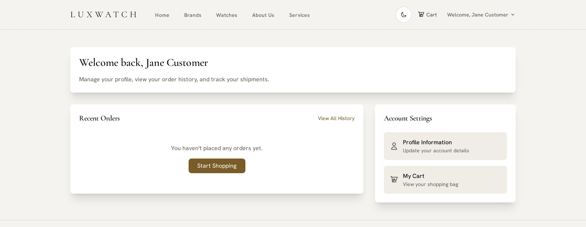</a>

**What you see.** After signing in as a customer you land on the home page, and your dashboard is one click away. It says "Welcome back" with your name, lists your recent orders (with **Start Shopping** while there are none) and links to your **Profile Information** and **My Cart**.

**What to do.** Open a watch and press the add to cart button. Your cart comes next.

<a href="docs/images/customer-cart.jpg">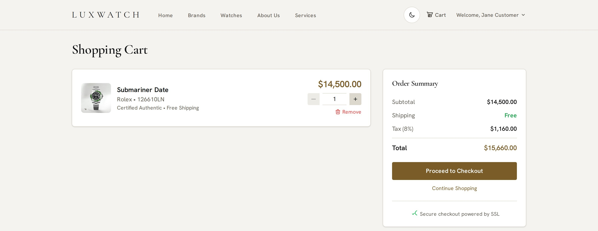</a>

**The cart.** Each watch shows its brand, reference and price with a quantity stepper and a **Remove** link. The **Order Summary** adds the subtotal, shipping (free), tax at 8% and the total. **Proceed to Checkout** continues, and **Continue Shopping** goes back.

<a href="docs/images/customer-checkout.jpg">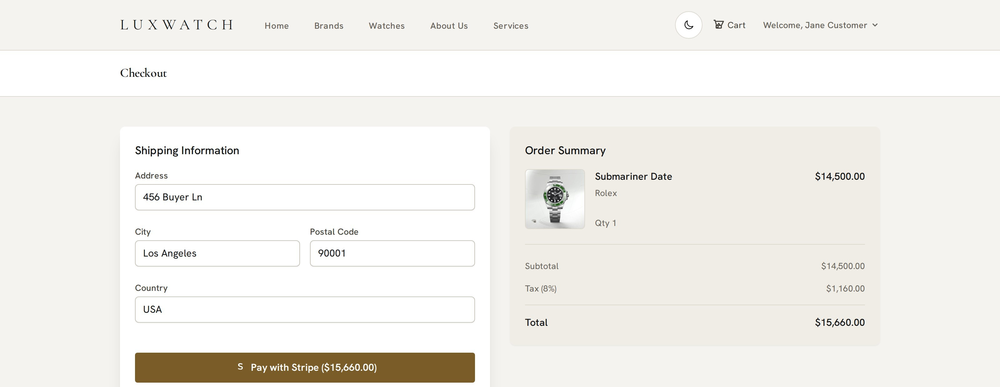</a>

**Checkout.** Fill in the address, city, postal code and country. The button reads **Pay with Stripe** and shows the total. In this walkthrough a $14,500 watch comes to $15,660.00 with 8% tax. The card itself is typed on Stripe, never on this site, and the picture stops before the payment because the local copy has no Stripe keys.

<a href="docs/images/customer-orders.jpg">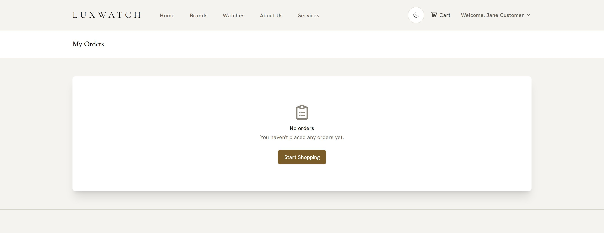</a>

**My orders.** Paid orders appear here. A new account has none yet, as shown.

### 12. The seller area

<a href="docs/images/seller-dashboard.jpg">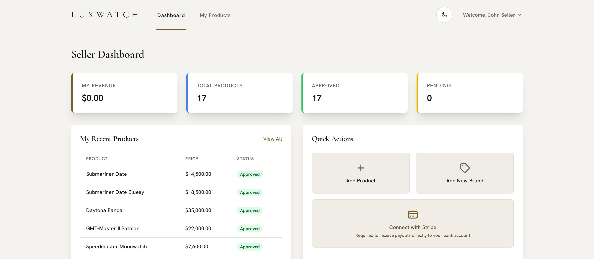</a>

**What you see.** A seller lands on their own dashboard: **My Revenue**, **Total Products**, **Approved** and **Pending** counts, a table of recent products, and quick actions to **Add Product**, **Add New Brand** and **Connect with Stripe**.

**What to do.** Connect Stripe so you can be paid, then list a watch. Everything a seller adds waits for an admin.

<a href="docs/images/seller-products.jpg">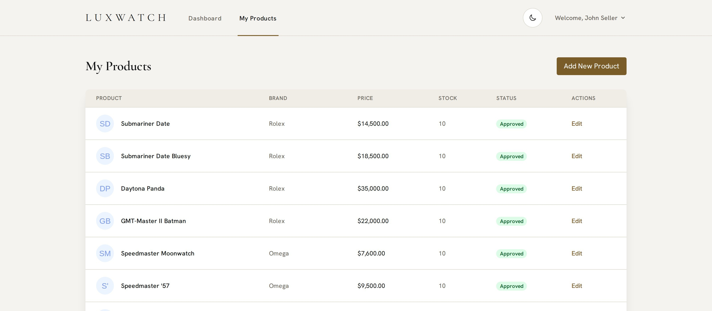</a>

**My products.** One row for each of the seller's watches with its brand, price, stock and status (**Approved** or waiting), and an **Edit** link. **Add New Product** is at the top. A seller only ever sees their own products and orders, and moves each order from pending to accepted to shipped.

### 13. The admin area and approvals

<a href="docs/images/admin-dashboard.jpg">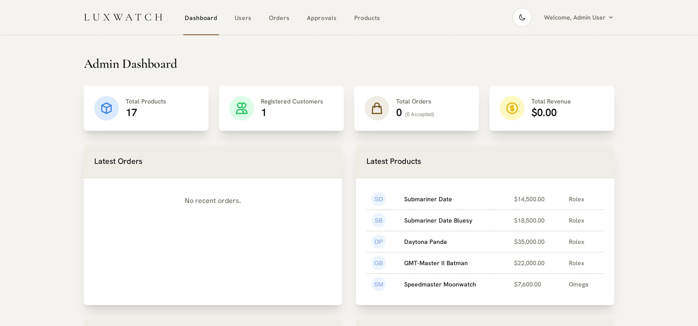</a>

**What you see.** The admin sees the whole store at a glance: **Total Products**, **Registered Customers**, **Total Orders** and **Total Revenue**, with the latest orders, products, customers and reviews under them. The menu at the top leads to **Users**, **Orders**, **Approvals** and **Products**.

<a href="docs/images/admin-users.jpg">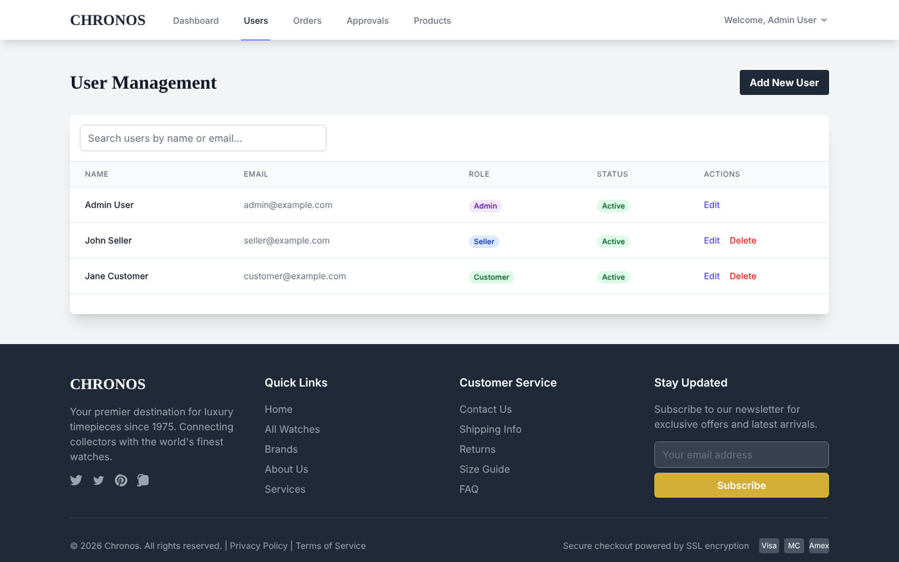</a>

**Users.** Search by name or email. Each person shows their role (customer, seller or admin) and whether the account is active, with **Edit** and **Delete**. **Add New User** creates an account by hand.

<a href="docs/images/admin-approvals.jpg">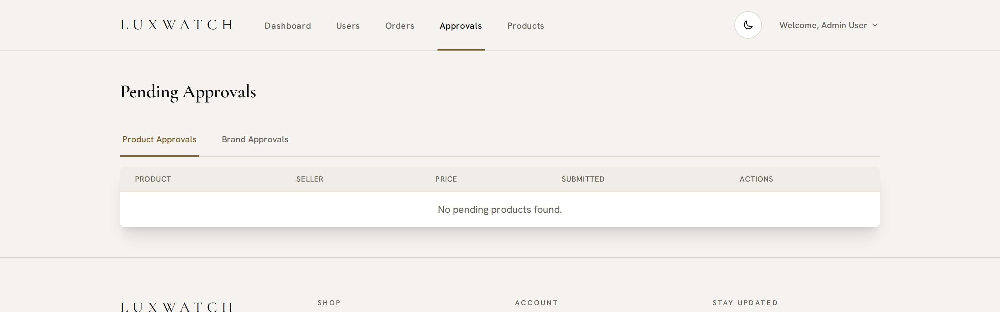</a>

**Approvals** is where watches and brands wait, on two tabs: **Product Approvals** and **Brand Approvals**. Only what an admin approves is shown in the shop, so what a visitor sees is what they can buy. The picture shows it empty, because the sample data is already approved.

<a href="docs/images/admin-orders.jpg">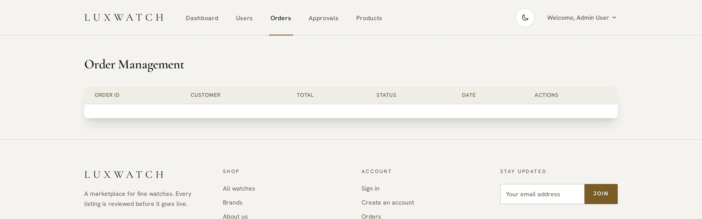</a>

**Orders** lists every order in the store with its customer, total, status and date. It is empty here because nothing has been bought in the sample data.

### Who can open what

The pages check who you are. In a test run with the sample accounts: a signed out visitor who opens the cart, orders, checkout, seller or admin pages is sent to the sign in page. A customer who opens an admin or seller page is sent back to the home page. A seller who opens an admin page is sent to the seller dashboard. [Roles and areas](docs/Roles%20and%20areas.md) explains the rules.

### 14. On a phone

<p align="center">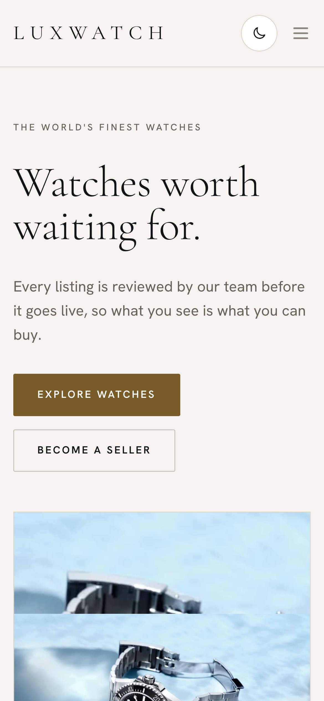 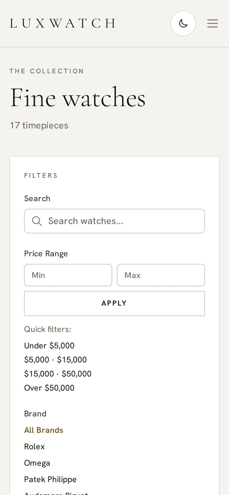 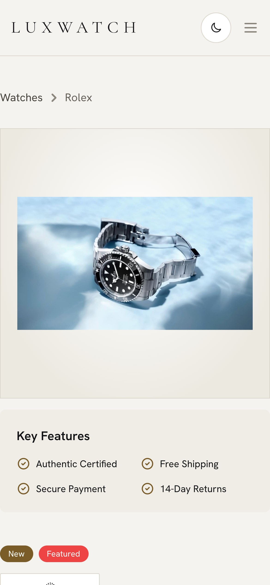 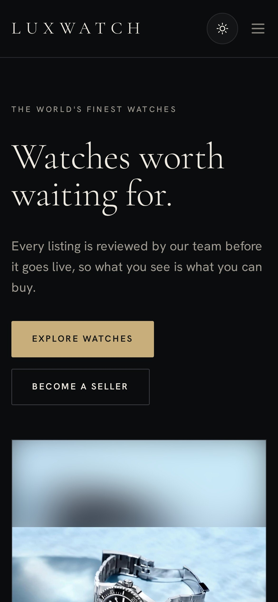</p>

The same pages, laid out for a small screen. The menu folds into the button at the top right, and the filters sit above the watches. The 360° view works with a finger, and horizontal drags turn the watch while up and down still scrolls the page.

<p align="center">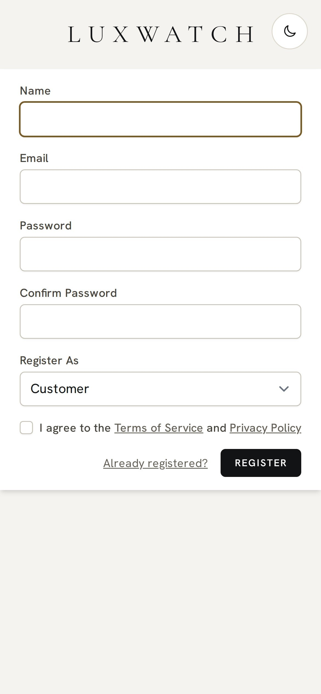</p>

## Under the hood

| Area | Choice |
|---|---|
| Framework | Laravel 12, PHP 8.2+ |
| Pages | Blade, Livewire 3, Alpine.js, Tailwind CSS, Vite |
| Sign in | Jetstream, Fortify, Sanctum, Socialite |
| Database | SQLite to try it, MySQL or Postgres online |
| Payments | Stripe Checkout and Stripe Connect |
| Hosting | Vercel with Neon, or Docker on Render with TiDB |
| Tests | PHPUnit, over 90 tests, run on every push |

The design is light by default with a dark switch, self hosted fonts (Cormorant Garamond, Hanken Grotesk and DM Mono) and one set of colour tokens that every page follows. Read [Design](docs/DESIGN.md) for the parts, [How it works](docs/How%20it%20works.md) for a map of the code, and [Roles and areas](docs/Roles%20and%20areas.md) for who can do what.

## Put it online

The live demo runs on **Vercel** with a **Neon** Postgres database. [Vercel and Neon](docs/Vercel%20and%20Neon.md) shows each step and the few things that had to change for serverless. If you prefer a classic server, [Deployment](docs/DEPLOYMENT.md) covers Docker on Render with a free TiDB MySQL database. All the settings are in [Configuration](docs/Configuration.md).

Keep the PHP runtime current. PHP had two critical security fixes in October 2026, and the live demo runs the patched PHP 8.4 runtime. See [Security](SECURITY.md).

## Your privacy and safety

* Cards are entered on Stripe, never on this site.
* Passwords are hashed. Two factor sign in is available.
* Roles are checked on every route and every API token, and tests make sure that stays true.
* The sample accounts use the password you give `SEED_PASSWORD`. **Set it before seeding any site other people can reach.** Without it the password is `password`.
* Uploaded images are stored in the database. That is fine for a prototype. A large store should use object storage.

To report a security problem, read [SECURITY.md](SECURITY.md).

## Help and more reading

| If you want to | Read |
|---|---|
| Run it on your computer | [Getting started](docs/Getting%20started.md) |
| See how the Flutter app uses this store | [The phone app](docs/The%20phone%20app.md) |
| Follow one watch from listing to delivery | [How everything fits](docs/How%20everything%20fits.md) |
| Know who can do what | [Roles and areas](docs/Roles%20and%20areas.md) |
| Add or change a 360° view | [The 360 viewer](docs/The%20360%20viewer.md) |
| Change colours, fonts or parts | [Design](docs/DESIGN.md) |
| Put it on Vercel with Neon | [Vercel and Neon](docs/Vercel%20and%20Neon.md) |
| Put it on Render with MySQL | [Deployment](docs/DEPLOYMENT.md) |
| Set a variable | [Configuration](docs/Configuration.md) |
| Call it from an app | [API reference](docs/API.md) |
| Fix a problem | [Fixing problems](docs/Fixing%20problems.md) |
| Find a quick answer | [Questions and answers](docs/FAQ.md) |
| Change the code | [How it works](docs/How%20it%20works.md) and [Contributing](CONTRIBUTING.md) |
| See what changed | [Changes](CHANGELOG.md) |

## Legal and the pictures

* This is a demonstration. It sells nothing, and any brand names are used only to describe the watches.
* **Brand photos and 360 frames.** The newest Rolex, Audemars Piguet and Swatch photos and turns used for the live demo belong to those brands. They are not in this repository (`public/images/spin/` and `public/images/products/*-new.*` are git ignored). Older photos that are in the repository are also third party pictures kept for a private showcase. Do not reuse them elsewhere, and replace them with your own before showing the store to the public.
* The code is under the [MIT licence](LICENSE). That covers the code only, not the third party photos above.
* It is provided as it is, with no promises.

## Contributing

Fixes and ideas are welcome. Read [CONTRIBUTING.md](CONTRIBUTING.md) first. It explains how to run the checks and what we ask of every change.

## Credits

Built by [Yusuf (Hikki-dev)](https://github.com/Hikki-dev). Laravel, Livewire, Alpine, Tailwind and Jetstream do the heavy lifting. Fonts are Cormorant Garamond, Hanken Grotesk and DM Mono through Fontsource.
