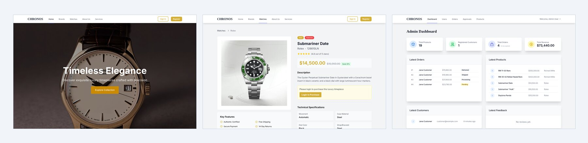
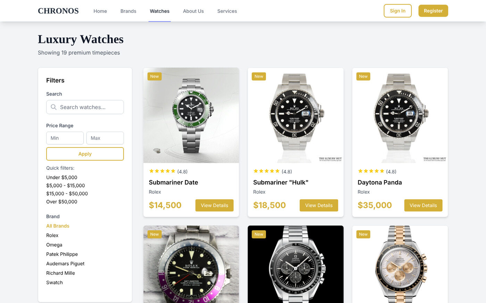
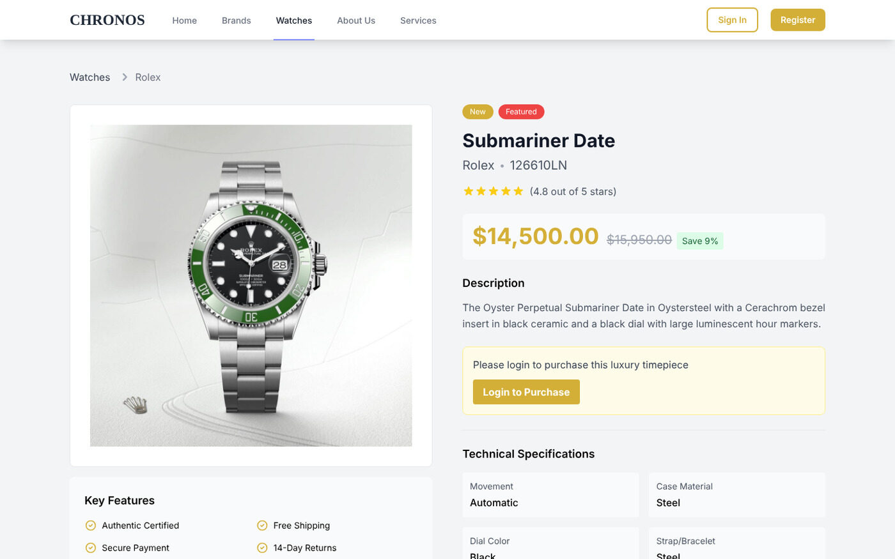
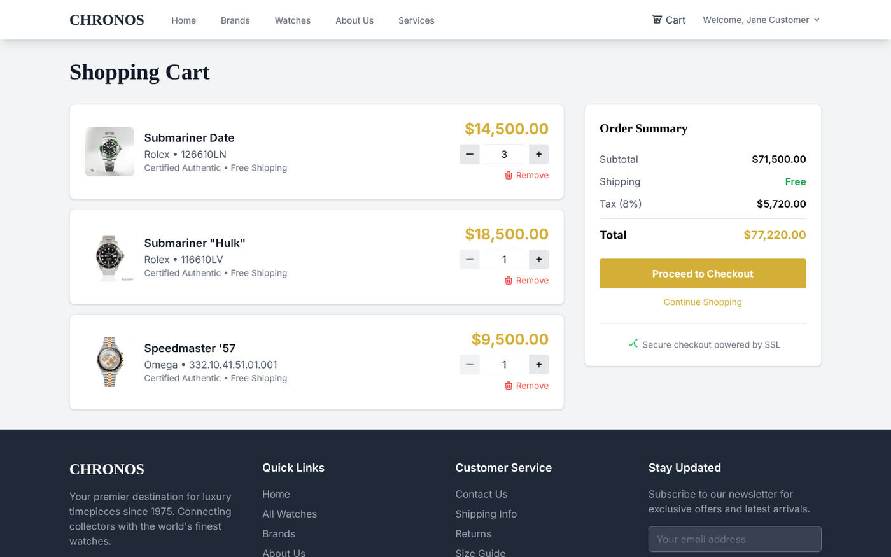
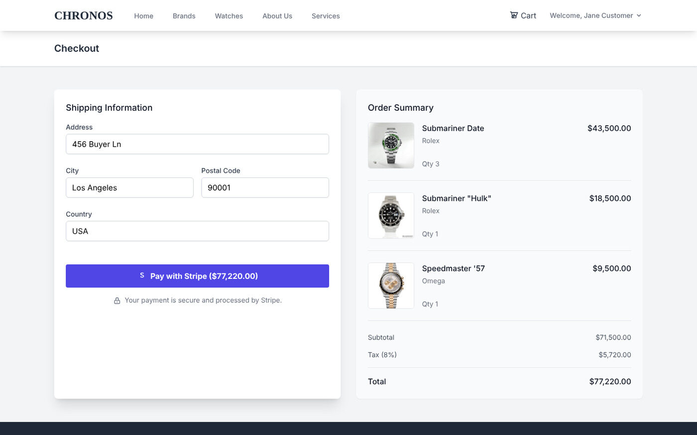

# Laravel-Watch

[](https://github.com/Hikki-dev/Laravel-Watch/actions/workflows/checks.yml)


[](https://github.com/Hikki-dev/Watch-final)

**Chronos**, a luxury watch marketplace. Customers browse and buy, sellers list their own watches, and an admin approves what goes on sale. One Laravel app serves the website and the REST API for the [Watch-final](https://github.com/Hikki-dev/Watch-final) phone app.

<p align="center"></p>

<p align="center"><sub>Real screenshots of the running app, with the sample data that <code>php artisan migrate --seed</code> creates.</sub></p>

It has three kinds of account, and each one gets its own screens:

* **Customers** search the catalogue, fill a cart and pay with Stripe.
* **Sellers** add watches and brands, follow their orders and connect a Stripe account to be paid.
* **Admins** see sales at a glance, approve or reject new listings and manage every user and order.

## On this page

* [What you get](#what-you-get)
* [How everything fits together](#how-everything-fits-together)
* [Try it](#try-it): run it on your computer in five minutes
* [A tour of the screens](#a-tour-of-the-screens)
* [The API for the phone app](#the-api-for-the-phone-app)
* [Configuration](#configuration)
* [Tests](#tests)
* [Known issues](#known-issues)
* [Help and more reading](#help-and-more-reading)

## What you get

| | |
|---|---|
| **Storefront** | Search that updates as you type (Livewire), filters by brand and price, watch pages with specifications and reviews |
| **Cart and checkout** | One cart per customer, 8% tax, and a real Stripe Checkout payment |
| **Sellers** | Their own dashboard, product and order management, and Stripe Connect sign-up so they can receive payouts |
| **Approvals** | New products and new brands wait as *pending* until an admin approves them |
| **Admin** | Revenue, orders, customers and users in one place. Roles can be changed |
| **Sign in** | Email and password, Google, two-factor codes and API tokens (Jetstream, Fortify, Socialite) |
| **Mobile API** | A token-based REST API with different permissions for each role. See [docs/API.md](docs/API.md) |
| **Ready to host** | A `Dockerfile` and a `Procfile`. The hosted copy runs on Railway with MySQL |

## How everything fits together

The website and the phone app are two doors into the same app, so a watch added by a seller shows up in both.

<p align="center"><a href="docs/images/how-it-fits.svg"></a></p>

Paying is the part with the most moving pieces. The site creates the order first, then hands the customer to Stripe, and checks with Stripe when they come back.

<p align="center"><a href="docs/images/checkout-flow.svg"></a></p>

The long version, with the data model and the roles, is in [How it works](docs/How%20it%20works.md).

## Try it

You need PHP 8.2 or newer, [Composer](https://getcomposer.org) and Node 20 or newer. The default setup uses SQLite, so there is no database to install.

```bash
git clone https://github.com/Hikki-dev/Laravel-Watch.git
cd Laravel-Watch
composer install
npm install
cp .env.example .env
php artisan key:generate
touch database/database.sqlite
php artisan migrate --seed
npm run build
php artisan serve
```

Open <http://127.0.0.1:8000>. The sample data adds 17 watches from six brands and three accounts to sign in with:

| Role | Email | Password |
|---|---|---|
| Admin | `admin@example.com` | `password` |
| Seller | `seller@example.com` | `password` |
| Customer | `customer@example.com` | `password` |

These accounts are for your own computer only. Never seed them on a public server.

Paying needs a Stripe test key in `.env` (`STRIPE_SECRET`). Everything else works without one. Step by step, with fixes for the usual snags, is in [Getting started](docs/Getting%20started.md).

**Hosted copy.** The phone app talks to a copy on Railway at `https://laravel-watch-production.up.railway.app`. How to host your own is in [Deploying](docs/Deploying.md).

## A tour of the screens

Click a picture to see it full size.

### The storefront

<a href="docs/images/products.jpg"></a>

Search, a price range, quick price buttons and a brand list narrow the catalogue without reloading the page.

<a href="docs/images/product.jpg"></a>

Each watch has its price, the saving against the original price, a description and a table of specifications. A visitor who is not signed in is asked to log in to buy.

### Cart, checkout and orders

<a href="docs/images/cart.jpg"></a>

<a href="docs/images/checkout.jpg"></a>

The checkout form asks for a shipping address, then sends the customer to Stripe to pay. The tax is shown as its own line.

### Sellers

<a href="docs/images/seller-dashboard.jpg"></a>

A seller sees their revenue, how many of their listings are approved or waiting, and a button to connect a Stripe account so they can be paid.

### Admins

<a href="docs/images/admin-dashboard.jpg"></a>

The dashboard refreshes itself every ten seconds.

<a href="docs/images/admin-approvals.jpg"></a>

Nothing a seller adds goes on sale until an admin presses **Approve**. Brands have their own tab.

<a href="docs/images/admin-orders.jpg"></a>

### On a phone

<p align="center"></p>

The website adapts to small screens. For a real phone app, see [Watch-final](https://github.com/Hikki-dev/Watch-final).

## The API for the phone app

The REST API is under `/api` and uses [Laravel Sanctum](https://laravel.com/docs/sanctum) bearer tokens. What a token is allowed to do depends on the role:

| Role | Token abilities |
|---|---|
| Admin | everything |
| Seller | create, update and delete products |
| Customer | place orders |

The main groups are sign in (email, or a Google sign-in checked with Firebase), products and brands, cart, orders, favourites, reviews, profile, seller products, and admin approvals and users. Every route, with its request and its answer, is in **[docs/API.md](docs/API.md)**.

## Configuration

Everything is set in `.env`. `.env.example` has the defaults.

| Variable | What it does |
|---|---|
| `APP_KEY`, `APP_URL`, `APP_ENV`, `APP_DEBUG` | The basics. Use `APP_DEBUG=false` on a public server |
| `DB_CONNECTION` and `DB_*` | The database. SQLite by default, MySQL in production (`DB_URL` or the `MYSQL*` names Railway gives) |
| `STRIPE_SECRET` | Stripe Checkout and Stripe Connect |
| `FIREBASE_WEB_API_KEY` | Used to check a Google sign-in from the phone app |
| `GOOGLE_CLIENT_ID`, `GOOGLE_CLIENT_SECRET`, `GOOGLE_REDIRECT_URL` | Google sign-in on the website |
| `MAIL_*` | Email for verification and password reset |

## Tests

```bash
php artisan test
```

The tests run on an in-memory database, so they never touch your own data. **At the moment 58 pass, 27 fail and 1 is skipped.** The failures are in the role access, role redirect, brand approval, product, user management and cart API tests, and in two of the stock sign-in tests. Many of them are signed-in test users being sent to the login page, so the cause is probably in the test setup rather than in the app, and the screens above work. The list is in [Fixing problems](docs/Fixing%20problems.md#the-test-suite-has-failures). Because of this the Checks badge above only covers the build, not the tests.

## Known issues

Read these before putting it on the internet.

1. **Seeded accounts have a known password.** Never run the seeder on a public server.
2. **`GET /api/products` returns every product**, including pending and rejected ones. Filter by `status` and `is_active` before using it for a public list.
3. **Payment is confirmed when the customer returns to the site.** There is no Stripe webhook, so a customer who pays and then closes the tab leaves an order that stays unpaid. The stock for an order is taken when the order is created, so an abandoned checkout keeps that stock reserved until someone fixes the order.
4. **Images are stored in the database** (`image_data` columns), and `/api/image-proxy` serves files from `public/`. That is fine for a prototype and heavy for a big shop.
5. `submission.zip`, a coursework hand-in, is still in the repository root. It can be deleted.

An old `/fix-db` route that wiped and re-seeded the database from the web was removed. See the [changes](CHANGELOG.md).

## Help and more reading

| If you want to | Read |
|---|---|
| Set it up step by step | [Getting started](docs/Getting%20started.md) |
| Understand how it is built | [How it works](docs/How%20it%20works.md) |
| Call the API | [API reference](docs/API.md) |
| Put it on a server | [Deploying](docs/Deploying.md) |
| Fix a problem | [Fixing problems](docs/Fixing%20problems.md) |
| Find a quick answer | [Questions and answers](docs/FAQ.md) |
| Change the code | [Contributing](CONTRIBUTING.md) |
| Report a security problem | [SECURITY.md](SECURITY.md) |
| See what changed | [Changes](CHANGELOG.md) |

## Contributing

Fixes and ideas are welcome. Read [CONTRIBUTING.md](CONTRIBUTING.md) first.

## Credits

Built with [Laravel](https://laravel.com), [Jetstream](https://jetstream.laravel.com), [Livewire](https://livewire.laravel.com), [Tailwind CSS](https://tailwindcss.com) and [Stripe](https://stripe.com). The watch photographs and brand logos belong to their owners and are here as sample content only.

## Licence

Laravel itself is open-source software under the [MIT licence](https://opensource.org/licenses/MIT). This project's own code has no licence file yet, so for now all rights are reserved by the author.

Built by [Yusuf (Hikki-dev)](https://github.com/Hikki-dev).
