# LUXWATCH

[](https://github.com/Hikki-dev/Laravel-Watch/actions/workflows/checks.yml)
[](https://luxwatch-livid.vercel.app)


A luxury watch marketplace you can try in your browser. Buyers find a watch and turn it in their hands, sellers list their own, and an admin approves everything before it goes live.

<p align="center"><a href="https://luxwatch-livid.vercel.app">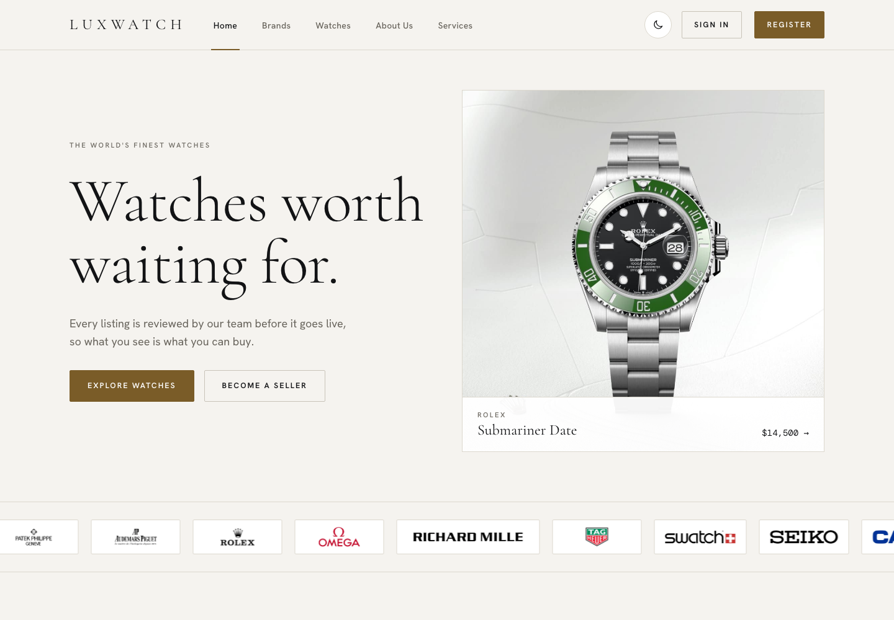</a></p>

It is a portfolio project, built to show how a careful, well designed store is put together from the first page to the payout. It also powers the [Watch-final](https://github.com/Hikki-dev/Watch-final) Flutter app through a REST API.

You do not need to know Laravel to follow this page. Everything is explained in plain words, one step at a time.

## On this page

* [What you get](#what-you-get): the parts of the store
* [How everything fits together](#how-everything-fits-together): from a click to the database
* [Try it first](#try-it-first): the live demo
* [Before you start](#before-you-start): what your computer needs
* [Run it](#run-it): ten minutes to a working store
* [A tour of the store](#a-tour-of-the-store)
  * [1. The home page](#1-the-home-page)
  * [2. The collection](#2-the-collection)
  * [3. A watch up close](#3-a-watch-up-close)
  * [4. Brands](#4-brands)
  * [5. Signing in](#5-signing-in)
  * [6. The customer area](#6-the-customer-area)
  * [7. The seller area](#7-the-seller-area)
  * [8. The admin area](#8-the-admin-area)
  * [9. On a phone](#9-on-a-phone)
* [Under the hood](#under-the-hood)
* [Put it online](#put-it-online)
* [Your privacy and safety](#your-privacy-and-safety)
* [Help and more reading](#help-and-more-reading)
* [Legal and the pictures](#legal-and-the-pictures)

## What you get

Each part does one small job. Together they make a store that feels like the real ones.

| | What | What it does |
|---|---|---|
| 🛍️ | **Storefront** | A light and dark theme, brand logos, search, filters and photos that always fit |
| 🔄 | **360° views** | Drag a watch round with your finger, the way the big brand sites do |
| 👤 | **Three roles** | Customers buy, sellers list, admins approve |
| ✅ | **Approvals** | New watches and brands stay hidden until an admin says yes |
| 🛒 | **Cart and checkout** | Stripe Checkout, tax added, order history |
| 💸 | **Seller payouts** | Stripe Connect pays sellers when they sell |
| 🔐 | **Sign in** | Email and password, Google, two factor, API tokens (Jetstream) |
| 📱 | **REST API** | Token based, used by the Flutter app. See the [API reference](docs/API.md) |
| ☁️ | **Serverless ready** | Runs on Vercel with a Neon Postgres database, or on a normal server with MySQL |

## How everything fits together

A visitor opens a page. Vercel serves the photos and scripts straight away, and asks Laravel for the page itself. Laravel reads the watches from the database, builds the page and sends it back. The phone app asks the same Laravel for JSON instead. Payments go to Stripe.

<p align="center"><a href="docs/images/how-it-fits.svg"></a></p>

The full story of one watch, from a seller listing it to a customer receiving it, is in [How everything fits](docs/How%20everything%20fits.md).

## Try it first

**[Open the live demo](https://luxwatch-livid.vercel.app).** Browse the collection, search, filter by brand, open a watch and register as a customer. Nothing is sold, and no real money moves.

The seller and admin accounts are private, but the [tour below](#a-tour-of-the-store) shows every screen of them.

## Before you start

You need three things:

1. PHP 8.2 or newer and Composer.
2. Node 20 or newer.
3. Nothing else. The first run uses a SQLite file, so there is no database to install.

## Run it

```bash
git clone https://github.com/Hikki-dev/Laravel-Watch.git
cd Laravel-Watch
composer install
npm install
cp .env.example .env
php artisan key:generate
touch database/database.sqlite
php artisan migrate --seed
npm run build
php artisan serve
```

Open <http://localhost:8000>. The seeder makes 17 watches and three accounts (`customer@`, `seller@` and `admin@example.com`, password `password`). Check everything with `php artisan test`.

More detail, and what to do if something does not work, is in [Getting started](docs/Getting%20started.md) and [Fixing problems](docs/Fixing%20problems.md).

## A tour of the store

Every picture below was taken from a fresh clone of this repository, so what you see is what you get. Click a picture to see it full size.

### 1. The home page

<a href="docs/images/01-home.png"></a>

A big headline, one featured watch and a row of real brand logos that scrolls by itself. Under it come the newest arrivals and a shortcut to each brand. The moon button switches to the dark theme, and your choice is remembered.

### 2. The collection

<a href="docs/images/02-collection.png">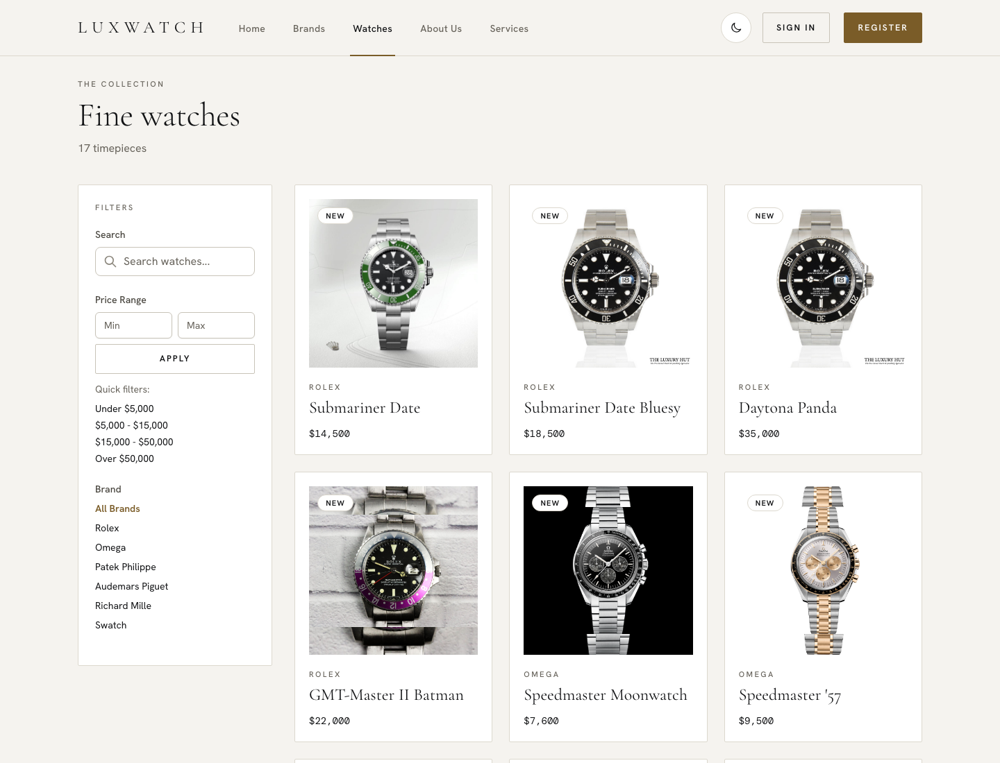</a>

Every approved watch, with a search box, a price range and a brand list on the left. Search is live: it answers while you type. Photos from different sources, with black, white or studio backgrounds, all sit neatly in the same square.

### 3. A watch up close

<a href="docs/images/03-watch.png">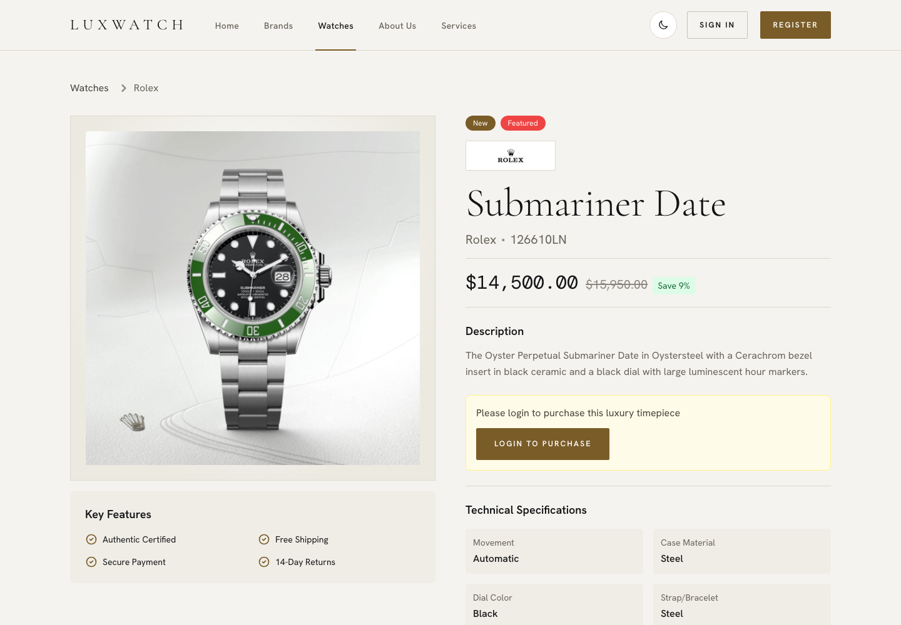</a>

The photo, the brand, the reference number, the price and a plain description. Below come the technical details: movement, case, dial, strap and water resistance.

When a watch has a 360° set, a **360°** tab appears. You drag the watch round, and buttons jump to the front, the angle, the side or the case back. It is a row of photos, not a 3D model, so it is smooth even on a phone. The full story is in [The 360 viewer](docs/The%20360%20viewer.md).


### 4. Brands

<a href="docs/images/04-brands.png">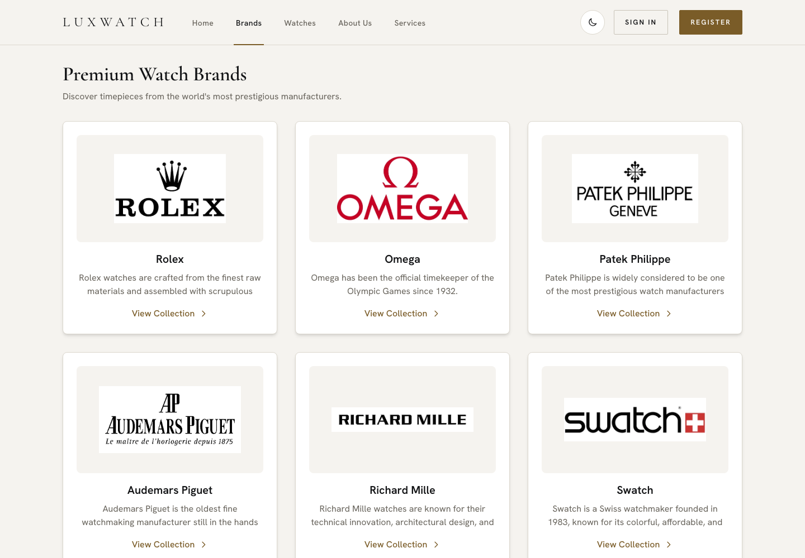</a>

One card for each maker, with its logo and a short description. Admins approve new brands before they appear. Every logo comes from one shared component, so it looks the same on every page.

### 5. Signing in

<a href="docs/images/05-sign-in.png">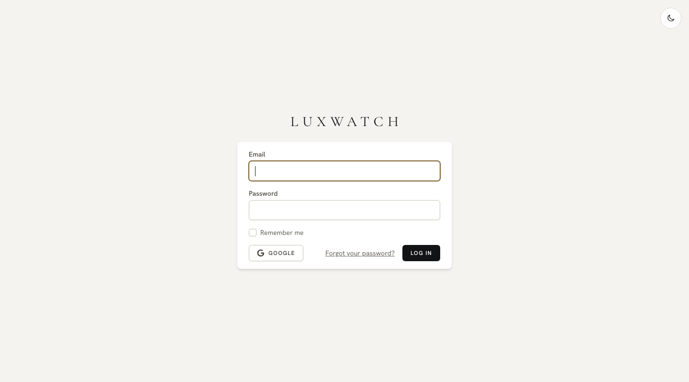</a>

Email and password, or Google. Two factor sign in and personal API tokens are in the profile. An account can be switched off by an admin, and it is signed out on its next click.

### 6. The customer area

<a href="docs/images/06-customer.png">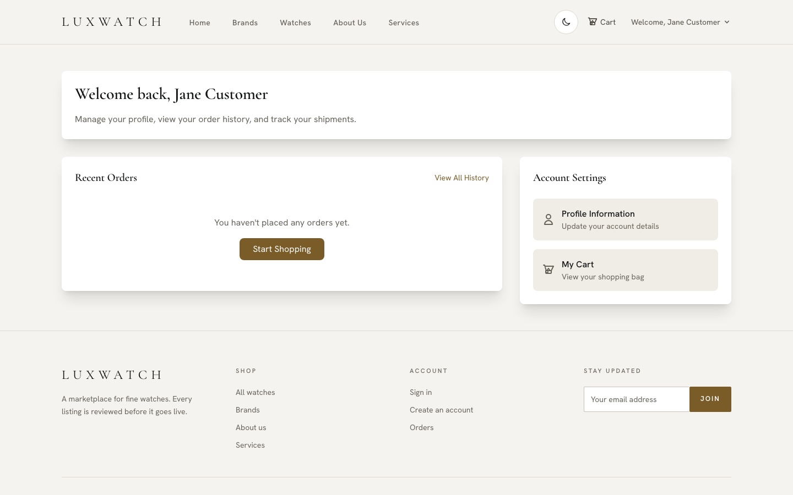</a>

A customer sees their recent orders, adds watches to a cart, pays with Stripe and keeps favourites. Tax of 8% is added at checkout.

### 7. The seller area

<a href="docs/images/07-seller.png">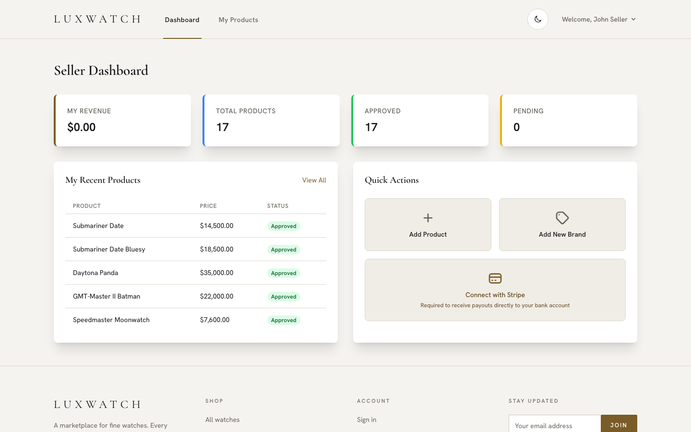</a>

Sellers list their own watches and brands, see only their own orders, and move each one from pending to accepted to shipped. They connect Stripe so they can be paid. Everything they add waits for an admin.

### 8. The admin area

<a href="docs/images/08-admin.png">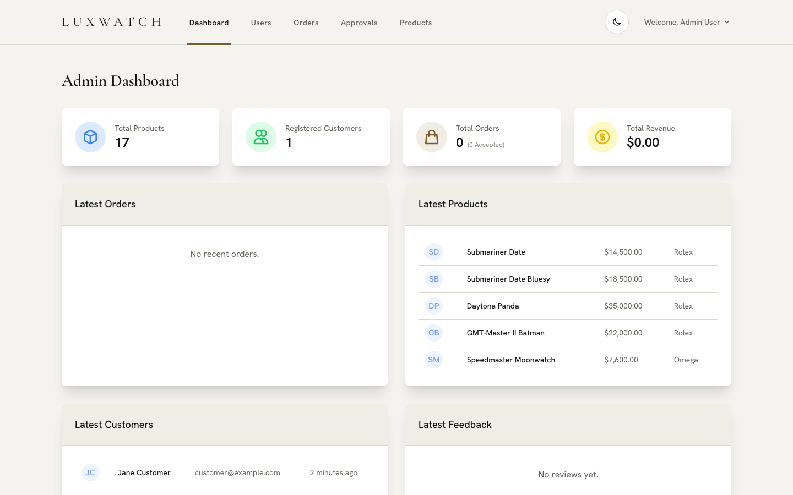</a>

The admin sees the whole store at a glance: products, customers, orders and revenue. From here they manage users and read every order.

<a href="docs/images/09-approvals.png">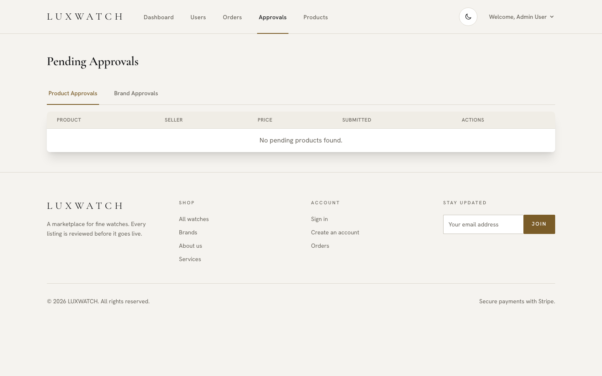</a>

**Approvals** is where watches and brands wait. Only what an admin approves is shown in the shop, so what a visitor sees is what they can buy.

<a href="docs/images/10-orders.png">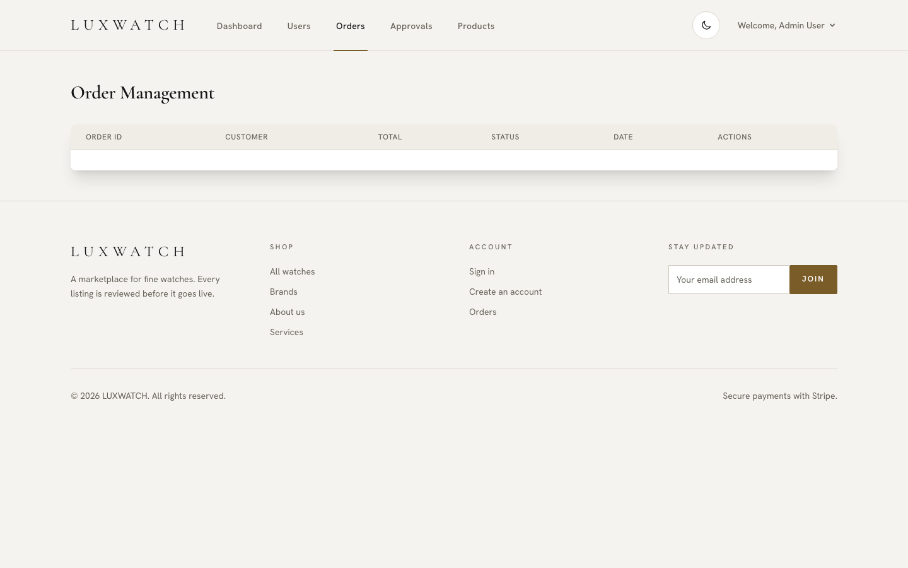</a>

### 9. On a phone

<p align="center">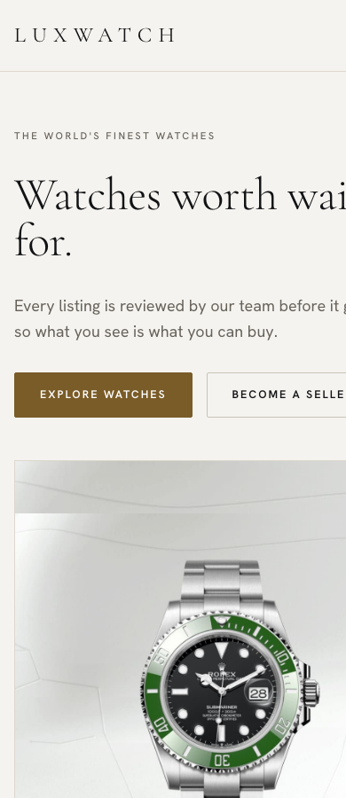 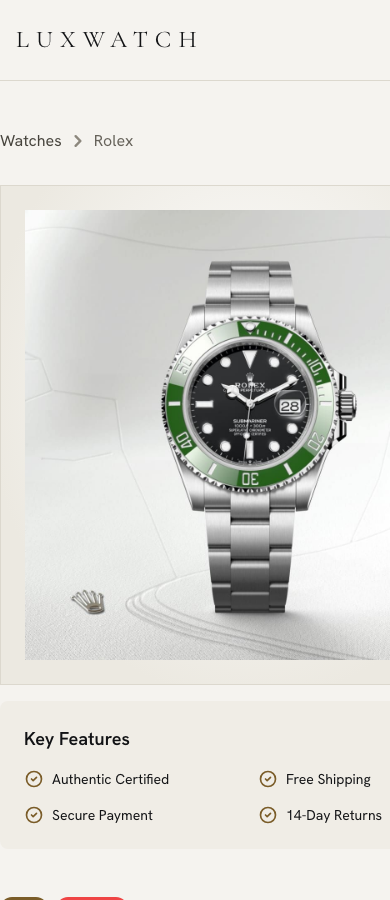</p>

The same pages, laid out for a small screen. The 360° view works with a finger, and horizontal drags turn the watch while up and down still scrolls the page.

## Under the hood

| Area | Choice |
|---|---|
| Framework | Laravel 12, PHP 8.2+ |
| Pages | Blade, Livewire 3, Alpine.js, Tailwind CSS, Vite |
| Sign in | Jetstream, Fortify, Sanctum, Socialite |
| Database | SQLite to try it, MySQL or Postgres online |
| Payments | Stripe Checkout and Stripe Connect |
| Hosting | Vercel with Neon, or Docker on Render with TiDB |
| Tests | PHPUnit, over 90 tests, run on every push |

The design is light by default with a dark switch, self hosted fonts (Cormorant Garamond, Hanken Grotesk and DM Mono) and one set of colour tokens that every page follows. Read [Design](docs/DESIGN.md) for the parts, [How it works](docs/How%20it%20works.md) for a map of the code, and [Roles and areas](docs/Roles%20and%20areas.md) for who can do what.

## Put it online

The live demo runs on **Vercel** with a **Neon** Postgres database. [Vercel and Neon](docs/Vercel%20and%20Neon.md) shows each step and the few things that had to change for serverless. If you prefer a classic server, [Deployment](docs/DEPLOYMENT.md) covers Docker on Render with a free TiDB MySQL database. All the settings are in [Configuration](docs/Configuration.md).

## Your privacy and safety

* Cards are entered on Stripe, never on this site.
* Passwords are hashed. Two factor sign in is available.
* Roles are checked on every route and every API token, and tests make sure that stays true.
* The sample accounts use the password you give `SEED_PASSWORD`. **Set it before seeding any site other people can reach.** Without it the password is `password`.
* Uploaded images are stored in the database. That is fine for a prototype. A large store should use object storage.

To report a security problem, read [SECURITY.md](SECURITY.md).

## Help and more reading

| If you want to | Read |
|---|---|
| Run it on your computer | [Getting started](docs/Getting%20started.md) |
| Follow one watch from listing to delivery | [How everything fits](docs/How%20everything%20fits.md) |
| Know who can do what | [Roles and areas](docs/Roles%20and%20areas.md) |
| Add or change a 360° view | [The 360 viewer](docs/The%20360%20viewer.md) |
| Change colours, fonts or parts | [Design](docs/DESIGN.md) |
| Put it on Vercel with Neon | [Vercel and Neon](docs/Vercel%20and%20Neon.md) |
| Put it on Render with MySQL | [Deployment](docs/DEPLOYMENT.md) |
| Set a variable | [Configuration](docs/Configuration.md) |
| Call it from an app | [API reference](docs/API.md) |
| Fix a problem | [Fixing problems](docs/Fixing%20problems.md) |
| Find a quick answer | [Questions and answers](docs/FAQ.md) |
| Change the code | [How it works](docs/How%20it%20works.md) and [Contributing](CONTRIBUTING.md) |
| See what changed | [Changes](CHANGELOG.md) |

## Legal and the pictures

* This is a demonstration. It sells nothing, and any brand names are used only to describe the watches.
* **Brand photos and 360 frames.** The newest Rolex, Audemars Piguet and Swatch photos and turns used for the live demo belong to those brands. They are not in this repository (`public/images/spin/` and `public/images/products/*-new.*` are git ignored). Older photos that are in the repository are also third party pictures kept for a private showcase. Do not reuse them elsewhere, and replace them with your own before showing the store to the public.
* The code is yours to learn from. No separate licence is declared for it yet.
* It is provided as it is, with no promises.

## Contributing

Fixes and ideas are welcome. Read [CONTRIBUTING.md](CONTRIBUTING.md) first. It explains how to run the checks and what we ask of every change.

## Credits

Built by [Yusuf (Hikki-dev)](https://github.com/Hikki-dev). Laravel, Livewire, Alpine, Tailwind and Jetstream do the heavy lifting. Fonts are Cormorant Garamond, Hanken Grotesk and DM Mono through Fontsource.
