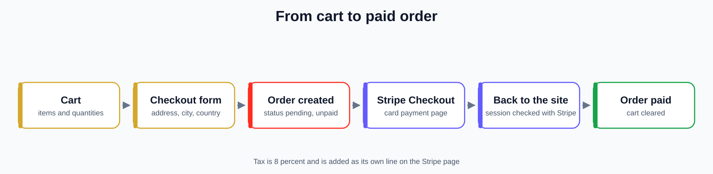

# How it works

This is the map for anyone who wants to change the code.

## One app, two front doors

Laravel-Watch is a single Laravel 12 app.

* **The website** is built from Blade pages. The live parts (search, the admin dashboard, user management, seller orders) are Livewire components, with Alpine.js for small things like menus. Tailwind CSS and Vite make the styles.
* **The API** is in `routes/api.php` and the controllers in `app/Http/Controllers/Api`. It answers with JSON and is what the [Watch-final](https://github.com/Hikki-dev/Watch-final) phone app calls.

Both use the same models, so a product added on the website shows up in the app at once.

<p align="center"><a href="images/how-it-fits.svg"></a></p>

## Roles

Every user has a `role`: `customer` (the default), `seller` or `admin`.

* **On the website**, `app/Http/Middleware/RoleMiddleware.php` guards the `admin` and `seller` route groups. Someone with the wrong role is sent to their own home page. `EnsureUserIsActive` signs out anyone whose `is_active` flag is off.
* **In the API**, the role decides which abilities a Sanctum token gets when it is made: `*` for an admin, product create, update and delete for a seller, and `order:create` for a customer. Routes check the ability.

## The data

| Table | What is in it |
|---|---|
| `users` | Name, email, `role`, `is_active`, address, Google id, Stripe account id and whether it is enabled, profile photo |
| `categories` | The brands. They have a `status`, so a seller's new brand waits for approval |
| `products` | The watches: price, stock, specifications, a `status` of pending, approved or rejected, and the seller who owns it |
| `product_images` | More pictures for a product |
| `carts` | One row per product in a customer's cart, with a quantity |
| `orders` and `order_items` | An order has a total, a shipping address, a `status` and a `payment_status`. Each item keeps the price at the time of purchase |
| `reviews` | A rating and a comment from a customer |
| `favorites` | The watches a customer has saved |

The migrations in `database/migrations` are the source of truth. `database/seeders/LegacyDataSeeder.php` fills in the sample shop.

## From cart to paid order

`CheckoutController` does this:

1. **Check out.** The form asks for an address, city, postal code and country. The subtotal plus 8% tax is the total.
2. **Create the order.** Inside a database transaction it creates an order that is `pending` and `unpaid`, copies the cart into order items and takes the stock off each product. If any product has too little stock, the whole thing is rolled back.
3. **Send to Stripe.** It creates a Stripe Checkout session with one line per watch and a separate tax line, and redirects the customer to it.
4. **Come back.** Stripe sends the customer to `/checkout/success/{order}`. The site asks Stripe for the session. If it is `paid`, the order's `payment_status` becomes `paid` and the cart is emptied. If not, the customer goes back to the cart with an error.

There is no Stripe webhook. If the customer never comes back to the site, the order stays unpaid. This is listed under [Known issues](../README.md#known-issues).

<p align="center"><a href="images/checkout-flow.svg"></a></p>

## Sellers and Stripe Connect

`StripeConnectController` makes a Stripe **Express** account for the seller and sends them to Stripe's own sign-up pages. When they come back, the app asks Stripe whether charges are enabled and saves that on the user. The seller dashboard shows the button until it is done.

## Approvals

A product or brand made by a seller starts as `pending`. An admin sees it under **Approvals** and presses Approve or Reject (`AdminController::approve`, `reject`, `approveCategory`, `rejectCategory`). Admins' own products and brands are approved straight away. When a seller edits a product, it goes back to `pending` for another look.

## Sign in

* **Website:** Jetstream and Fortify give email and password, email verification, password reset and two-factor codes. Google sign-in uses Socialite (`GoogleAuthController`).
* **Phone app:** `POST /api/login` gives a token for an email and password. `POST /api/auth/google` takes a Firebase ID token, checks it with Google using `FIREBASE_WEB_API_KEY`, and creates a customer the first time. It is limited to ten calls a minute.

## Pictures

Product and profile pictures are saved in the database (the `image_data` columns). The `/images/products/{id}` and `/images/users/{id}` routes serve them. `/api/image-proxy?path=...` serves files from `public/` with CORS headers, so the Flutter web build can show them.

## Where things are

```
app/
├── Http/Controllers/        # website controllers: storefront, cart, checkout, admin, seller
│   └── Api/                 # JSON controllers for the phone app
├── Http/Middleware/         # RoleMiddleware, EnsureUserIsActive
├── Livewire/                # ProductSearch, Admin/*, Seller/OrderManagement
├── Models/                  # User, Product, ProductImage, Category, Cart, Order,
│                            # OrderItem, Review, Favorite
└── Actions/                 # Fortify and Jetstream actions
routes/web.php               # storefront, admin and seller routes
routes/api.php               # REST API (Sanctum)
resources/views/             # Blade and Livewire views
database/                    # migrations, factories, seeders
tests/Feature/               # feature tests
Dockerfile, Procfile, docker-entrypoint.sh
```
